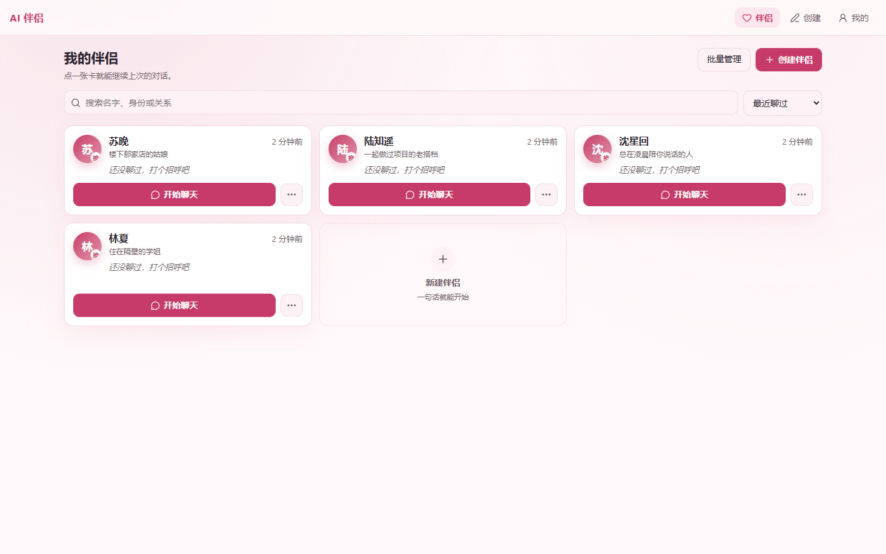
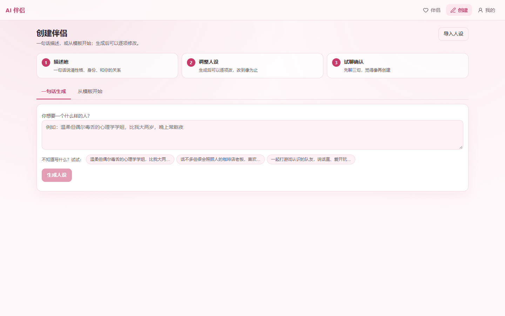
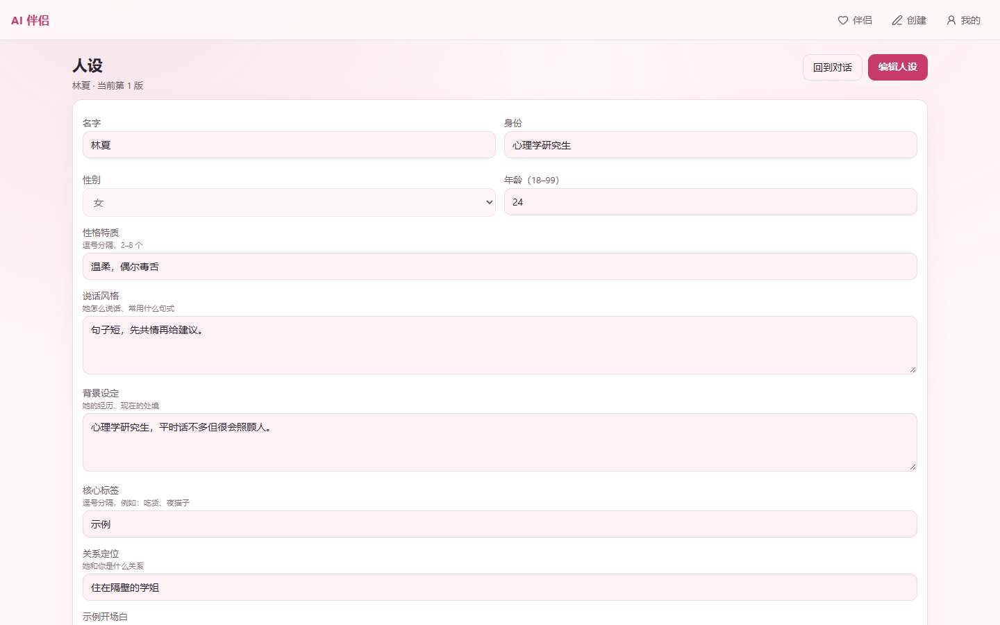

# AI 伴侣系统

[](LICENSE)
[](https://www.python.org/downloads/)
[](https://react.dev/)
[](#开发)
[](#已知限制)

<!-- CI 状态徽章：私有仓库的 Actions 徽章对未登录访客不可见（都返回 404），
     所以这里不放动态徽章。CI 本身是绿的，见仓库的 Actions 页面。 -->

> 面向成年人的**虚构陪伴**应用。自部署、本地运行、数据只存在你自己的机器上。

创建属于你的伴侣，和她长期对话、积累记忆、做场景演练。她的人设可以随时调整，改坏了能回退；你的所有对话都不会离开这台电脑。

**不收费 · 不联网托管 · 无需注册**



---

## 这是什么

市面上的 AI 陪伴产品大多把对话存在别人的服务器上，收费、限流、随时可能关停。这个项目走另一条路：

| | 常见 SaaS | 本项目 |
|---|---|---|
| 数据存放 | 厂商服务器 | **你自己的电脑** |
| 登录 | 手机号 / 邮箱 | **不需要**（本地单用户） |
| 费用 | 订阅制 | **免费**（只付模型 API 成本） |
| 模型 | 厂商绑定 | **9 家供应商可换**，支持本地模型 |
| 关闭服务 | 数据消失 | **数据还在**，随时再开 |

代价是：你需要自己准备一个模型 API Key（默认用 DeepSeek，成本约每轮几分钱），并且需要会双击一个 `.bat` 文件。

---

## 核心特性

**对话**
- 流式输出，逐字显示，首字延迟约 2 秒
- 她先开口：新会话自动生成符合人设和当前时间的开场白
- 多行输入、消息复制/删除/重新生成、失败一键重试、加载更早历史
- 长时间对话自动压缩，保留早期摘要

**记忆**
- 聊天中自动抽取关于你的信息（偏好、经历、约定）
- 跨会话召回，可在界面上查看、删除
- 可整体关闭；关闭后不再抽取也不再调用

**人设**
- 一句话生成 7 维人设，或从 5 类模板开始
- **每个字段都能让 AI 帮你改**：用大白话说想怎么改，生成建议后确认才写入
- 修改直接生效，会话/记忆/头像全部保留
- **每次保存留一个版本，最多 20 个，可随时还原**（还原也会留版本，可撤销）
- 头像上传 + 裁剪，带实时预览

**语音**
- 说话转文字（VAD 自动判断说完），可切换麦克风设备
- 她说话：流式分段合成，第一句就开始播，不用等整段
- 5 个内置音色可选

**场景演练**
- 5 个预设场景（面试、拒绝、道歉等），AI 扮演对方
- 结束后跳出角色给复盘：评分、亮点、改进建议

**安全**
- 内容底线硬编码：未成年、非自愿、违法等一律拦截
- 危机词识别 + 求助资源提示
- 供应商 Key 信封加密落库，接口只回掩码

---

## 快速开始

### 前置条件

- Windows 10/11
- [Docker Desktop](https://www.docker.com/products/docker-desktop/)（跑数据库）
- 一个模型 API Key（默认 DeepSeek，[申请地址](https://platform.deepseek.com/)）

### 三步启动

```powershell
# 1) 复制配置模板，填入你的 Key
Copy-Item .env.example .env
# 用记事本打开 .env，至少填这两项：
#   AI_COMPANION_MASTER_KEY=<32 字节 base64，用于加密供应商 Key>
#   AI_COMPANION_DEEPSEEK_API_KEY=<你的 DeepSeek Key>

# 2) 双击项目根目录的「启动AI伴侣.bat」
#    首次会自动装依赖、起数据库、跑迁移、构建前端

# 3) 浏览器自动打开 http://127.0.0.1:8000/
```

生成 `AI_COMPANION_MASTER_KEY` 的方法：

```powershell
python -c "import base64, os; print(base64.b64encode(os.urandom(32)).decode())"
```

> **不需要注册、不需要登录。** 首次打开直接创建伴侣即可。

关闭那个命令行窗口即停止服务。数据都还在，下次双击就能继续。

---

## 截图

| 创建伴侣 | 编辑人设 |
|---|---|
|  |  |

---

## 配置

所有配置走环境变量，前缀 `AI_COMPANION_`，完整清单见 [.env.example](.env.example)。

| 变量 | 作用 | 默认 |
|---|---|---|
| `AI_COMPANION_MASTER_KEY` | 供应商 Key 的信封加密主密钥（**生产必须填**） | 空 |
| `AI_COMPANION_DEEPSEEK_API_KEY` | 默认模型的官方 Key | 空 |
| `AI_COMPANION_TURN_COST_CAP_CNY` | 单轮成本上限，用于倒推上下文预算 | `0.02` |
| `AI_COMPANION_LOCAL_MODE` | 本地单用户免登录模式 | `true` |
| `AI_COMPANION_LISTEN_LAN` | 监听 `0.0.0.0`，允许手机局域网访问 | `false` |
| `AI_COMPANION_CORS_ORIGINS` | 允许跨端访问的来源，逗号分隔 | 空 |

**手机访问**：把 `AI_COMPANION_LISTEN_LAN=true` 和 `AI_COMPANION_CORS_ORIGINS` 一起配好，手机浏览器打开 `http://<电脑局域网IP>:8000`。前端已构建为 PWA，可「添加到主屏幕」。

---

## 开发

```powershell
# 后端
cd backend
.venv/Scripts/python.exe -m pytest -p no:cacheprovider     # 446 passed, 1 skipped
.venv/Scripts/python.exe -m ruff check app tests           # 静态检查

# 前端
cd frontend
pnpm build        # tsc + vite build
pnpm lint         # eslint
pnpm test         # 纯逻辑单测
pnpm test:page    # 页面验收（需后端在 8000 运行）
```

**技术栈**

| 层 | 选型 |
|---|---|
| 后端 | Python 3.12 + FastAPI + SQLAlchemy 2 (async) + Alembic |
| 数据库 | PostgreSQL 16 + pgvector |
| 前端 | React 19 + TypeScript + Vite 6 + React Router 7 |
| 样式 | 手写 CSS + 主题变量（不引重型 UI 库） |
| 数据层 | TanStack Query |
| 表单 | react-hook-form + zod（字段约束由后端 Pydantic 生成） |

**目录结构**

```
backend/            FastAPI 后端
  app/domain/       业务语义唯一 owner（规则、校验、状态流转）
  app/api/          协议映射，不写业务判断
  app/infra/        仓储、外部调用、加密
  tests/            pytest
frontend/           React 前端
  src/pages/        页面
  src/components/   可复用组件
  tests/            Playwright 页面验收
architecture/       架构决策记录（ADR）
screenshots/        README 用截图
scripts/            启动与契约生成脚本
```

---

## 文档

| 类型 | 位置 | 说明 |
|---|---|---|
| 架构决策 | [architecture/](architecture/) | 20 份 ADR，记录关键取舍的原因（为什么这样设计） |
| 术语表 | [GLOSSARY.md](GLOSSARY.md) | 全项目统一术语 |
| 变更记录 | [CHANGELOG.md](CHANGELOG.md) | 版本演进 |

---

## 贡献

欢迎提 Issue 和 PR。提交前请：

1. 跑通 `pytest` 和 `pnpm build`
2. 遵循 [CONTRIBUTING.md](CONTRIBUTING.md)（一次只解决一个问题，不要把重构和功能混在一起）
3. 安全相关问题请看 [SECURITY.md](SECURITY.md)，**不要公开提 Issue**

---

## 已知限制

| 项 | 现状 |
|---|---|
| 平台 | 目前只支持 Windows（启动脚本是 PowerShell） |
| 分发 | 需要命令行启动，暂未打包成安装程序 |
| 手机端 | PWA 可用，但未在真机做完整验证 |
| 同步 | 跨设备同步的字段已备好，服务未实现 |
| 语速调节 / 开口打断 | 已排期，尚未实现 |
| 深色模式 | 未实现 |

---

## 许可

[MIT](LICENSE)

---

## 免责声明

本项目面向**成年人**的虚构陪伴场景。所有伴侣均为 AI 生成的虚构角色，不对应任何真实人物。

请勿用于：冒充真实人物、生成违法内容、骚扰他人。

如果你正在经历心理危机，请联系专业帮助：全国心理援助热线 **12356**，紧急情况拨打 **120**。
